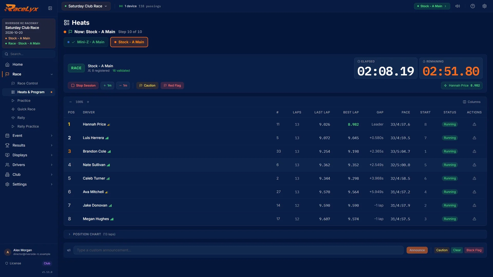

# RaceLyx

[RaceLyx](https://racelyx.com) is a new, actively maintained race timing and race management software for RC clubs and home tracks. It supports OpenStint natively.

RaceLyx runs on Windows. Results are published live to the web as cars cross the line, so spectators can follow the race from their phone.

