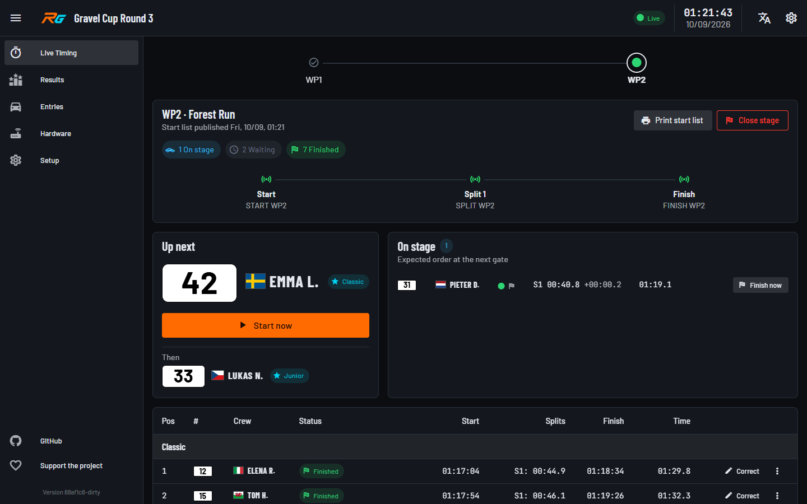

# RallyGate

[RallyGate](https://rallygate.app/) is open-source ([MIT](https://github.com/GerritK/rally-gate)) timing software tailor-made for RC rally events, rather than the usual circuit racing. It times special stages from start gate to finish gate, and shows stage times and the classification live at the service park.

Each gate is a Raspberry Pi. Transponder gates use a loop and an OpenStint decoder to recognise each car automatically. The gates and the timing laptop (Windows, Linux or Apple Silicon Mac) talk over the rally's own Wi-Fi, no internet needed. Any phone or tablet on the same Wi-Fi can follow the live times.

Downloads, the parts list and the installation guide are in the [GitHub repository](https://github.com/GerritK/rally-gate).

